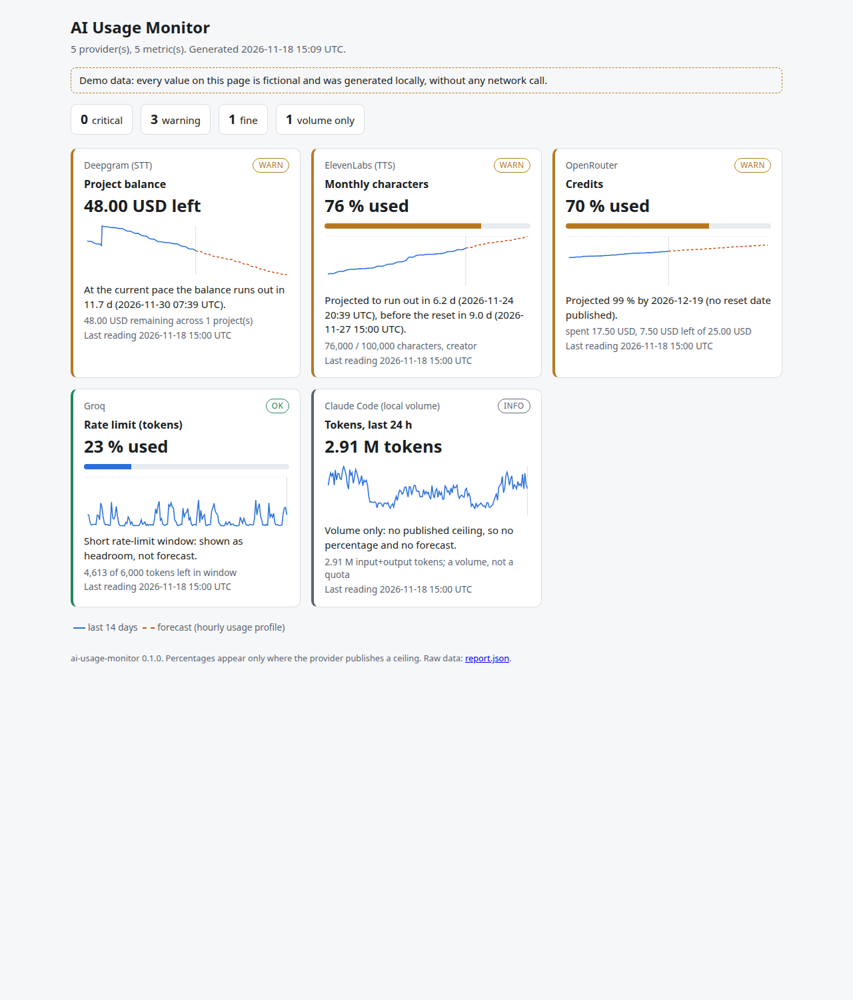

# AI Usage Monitor

One page that shows how much of each AI provider quota is used, how much prepaid balance is left,
and **when each one is going to run out**.



## The problem

AI quotas are shared and invisible. Several scripts, services and people use the same API keys;
each provider shows its own usage in its own console, if at all. Nobody looks until something
breaks: a batch job empties the monthly text-to-speech quota on Tuesday, and on Thursday a
different service starts failing with `429` or `402`, far from the cause.

AI Usage Monitor reads usage from each provider's **official, documented API**, keeps every reading
in SQLite, learns the usage rhythm (hour of day, day of week) and projects each quota or balance
to its next reset. The question it answers is not "how much have we used?" but "will it hold until
the reset, and if not, when does it break?".

## What it shows

For every metric, a card with:

- the current value: a percentage when the provider publishes a ceiling, otherwise a balance or a volume;
- a 14-day history and, for quotas and balances, a dashed forecast line;
- a plain-language outlook: "Projected to run out in 6.2 d, before the reset in 9.0 d";
- a status (`crit`, `warn`, `ok`, `info`) used to sort the page, worst first.

The same data is written to `report.json` for other tools (alerting, dashboards).

## Quick start with Docker

```bash
mkdir -p out
docker compose run --rm demo
xdg-open out/index.html    # or: open out/index.html
```

The demo seeds 30 days of fictional readings for five providers and renders the report, with no
network call and no key. For real data, copy `.env.example` to `.env`, fill the keys you have, then
run `docker compose run --rm monitor` (collect, then report). Schedule that command (cron, systemd
timer, CI job) every 30 to 60 minutes; the forecast needs readings at most 3 hours apart.

## Quick start without Docker

Python 3.11 or later, no third-party dependency.

```bash
python -m ai_usage_monitor demo --out out           # offline demo
export ELEVENLABS_API_KEY=your-key-here             # any subset of the keys in .env.example
python -m ai_usage_monitor collect                  # one reading per configured provider
python -m ai_usage_monitor report --out out         # out/index.html and out/report.json
```

`collect` prints one line per provider: `ok`, `skip` (key not set) or `error` (the call failed;
the other providers still run). It exits with code 1 only when a configured provider failed.

## Supported providers

| Provider | What is measured | Kind | Official endpoint | Variable |
|---|---|---|---|---|
| ElevenLabs (TTS) | characters used this month out of the plan limit, reset date | quota | `GET /v1/user/subscription` | `ELEVENLABS_API_KEY` |
| OpenRouter | credits spent out of credits purchased | quota | `GET /api/v1/credits` | `OPENROUTER_API_KEY` |
| Deepgram (STT) | prepaid balance, summed over the projects the key can see | balance | `GET /v1/projects`, `GET /v1/projects/{id}/balances` | `DEEPGRAM_API_KEY` |
| Gladia (STT) | hours transcribed and requests this month | volume | `POST /v2/{pre-recorded,live}/get-usage` | `GLADIA_API_KEY` |
| Groq | tokens and requests left in the current rate-limit window | rate | `x-ratelimit-*` headers of a 1-token completion | `GROQ_API_KEY` |
| Fireflies | meeting minutes consumed | volume, or quota if you declare the plan limit | GraphQL `user { minutes_consumed }` | `FIREFLIES_API_KEY`, `FIREFLIES_MONTHLY_MINUTES` |
| Claude Code | input and output tokens of the last 24 h, read from local transcripts (opt-in) | volume (not a quota) | local files `~/.claude/projects/**/*.jsonl` | `CLAUDE_PROJECTS_DIR` |

Only providers with an official usage API are supported.

## Resources to connect

| Resource | Needed for | Notes |
|---|---|---|
| API keys | each provider you want | read from environment variables (or `.env` with Docker); never stored, logged or rendered |
| Outbound HTTPS | `collect` | to the provider hosts listed above, nothing else |
| Inbound ports | nothing | no server is started; the report is a static file you can serve with any web server |
| Data directory | history | `AI_USAGE_DATA` (default `./data`, `/data` in Docker, a named volume in Compose): `history.db`, `latest.json`, `demo.db` |
| Output directory | the report | `--out` (default `./out`, `/out` in Docker): `index.html`, `report.json` |
| Claude Code transcripts | the Claude Code volume only | read-only access; in Docker add `- ${HOME}/.claude/projects:/claude:ro` to `volumes` and `CLAUDE_PROJECTS_DIR=/claude` to `.env` |

## Design choices

**No invented percentages.** A percentage is shown only when the provider publishes the ceiling
(ElevenLabs, OpenRouter, Groq), or when you declare it yourself (Fireflies). A prepaid balance is
shown as an amount, a volume as a count. A bar that guesses a limit looks precise and is wrong.
See [ADR 0002](docs/decisions/0002-no-invented-percentages.md).

**Official APIs only.** No scraping of web consoles, no session cookies. A probe that depends on an
undocumented endpoint breaks silently and puts an account at risk. See
[ADR 0001](docs/decisions/0001-official-apis-only.md).

**Forecast method.** For each quota (percentage toward 100) and each balance (amount toward zero):

1. Readings are paired into increments; a pair more than 3 h apart is ignored, and a drop (quota
   reset, balance top-up) starts a new cycle instead of counting as negative usage.
2. Increments of the last 14 days are spread over the clock hours they cover, giving a usage rate
   for each hour of the day, plus a day-of-week factor (damped by half, since a few weeks of data
   are noisy).
3. The current value is projected in 15-minute steps with that profile, up to the next reset when
   the provider gives one (31 days otherwise, 90 days for a balance). The first step that reaches
   the ceiling is the exhaustion time.
4. A constant-rate projection is computed alongside as a baseline and kept in `report.json`, so the
   profile method can be checked against the naive answer.

Fewer than 12 hours of usable history gives no forecast, and the card says why.

**Small surface.** Standard library only, one SQLite file, one static HTML page without
JavaScript. It runs anywhere Python runs and leaves nothing listening.

## Development

```bash
pip install -e '.[test]'
python -m pytest -q
```

To add a provider, see [AGENTS.md](AGENTS.md).

## License

MIT, see [LICENSE](LICENSE). Security reports: [SECURITY.md](SECURITY.md).
